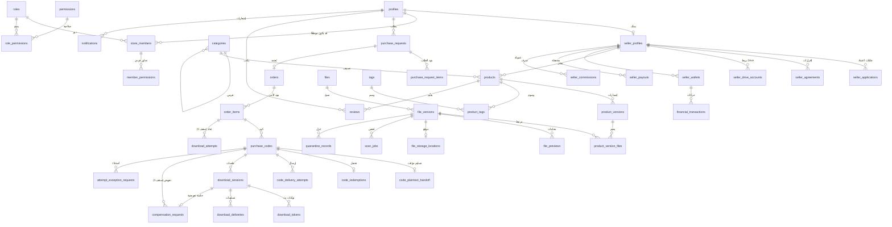

# ERD وقاموس البيانات — منصة المنتجات الرقمية
الإصدار: 1.3 (النهائي المحدّث شاملاً الترحيلات حتى `032`) — 21 نوفمبر 2026

## 1. الاصطلاحات العامة
- **المفاتيح الأساسية:** `UUID` مع `gen_random_uuid()` (باستثناء `audit_logs` و`security_events` و`redeem_attempts` من نوع `BIGSERIAL`، وجداول الإعدادات الأحد عشر من نوع `SMALLINT CHECK (id = 1)`).
- **الطوابع الزمنية:** `TIMESTAMPTZ` بتوقيت `UTC`.
- **المبالغ المالية:** `NUMERIC(18,4)` للعملات و`NUMERIC(18,8)` لأسعار الصرف + رمز العملة `CHAR(3)`.
- **الحذف:** لا حذف فيزيائي للكيانات الحساسة أو المرتبطة بمبيعات (`ON DELETE RESTRICT`)؛ يُستخدم الحذف الناعم (`status = 'deleted'`).
- **الأمان:** `RLS` مفعّل على كل جدول، والوصول افتراضيًا مرفوض (`Deny by default`).

---

## 2. خريطة العلاقات (Mermaid ERD)

---

## 3. جداول الهوية والأدوار والبائعين

### `profiles`
- `id` UUID PK (مرتبط بـ `auth.users.id`)
- `auth_provider` ENUM(`google`, `password`, `both`)
- `email` CITEXT UNIQUE NOT NULL
- `email_verified_at` TIMESTAMPTZ
- `phone` TEXT
- `full_name` TEXT
- `avatar_url` TEXT
- `account_type` ENUM(`buyer`, `seller`, `staff`)
- `status` ENUM(`active`, `suspended`, `deleted`)
- `mfa_enabled` BOOLEAN DEFAULT false
- `mfa_secret_encrypted` TEXT (مشفّر بـ `AES-256-GCM`)
- `mfa_enforced` BOOLEAN DEFAULT false
- `last_login_at`, `created_at`, `updated_at` TIMESTAMPTZ

### `seller_profiles`
- `profile_id` UUID PK FK→`profiles(id)` ON DELETE RESTRICT
- `display_name` TEXT NOT NULL
- `bio` TEXT
- `avatar_url` TEXT
- `status` ENUM(`pending`, `approved`, `rejected`, `suspended`)
- `agreement_accepted_at` TIMESTAMPTZ
- `agreement_version` TEXT
- `approved_by`, `approved_at`
- `rejected_by`, `rejected_at`, `rejection_reason`
- `suspended_by`, `suspended_at`, `suspension_reason`
- `created_at`, `updated_at`
- INDEX `(status)`

### `seller_applications` & `seller_agreements`
- `seller_applications`: `id`, `profile_id` FK→`seller_profiles`, `status`, `submitted_at`, `reviewed_by`, `reviewed_at`, `notes`
- `seller_agreements`: `id`, `profile_id` FK→`seller_profiles`, `version`, `accepted_at`, `ip`, `user_agent`

### `seller_drive_accounts`
- `id` UUID PK
- `seller_id` UUID FK→`seller_profiles(profile_id)` ON DELETE RESTRICT
- `google_account_email` CITEXT NOT NULL
- `encrypted_refresh_token` TEXT NOT NULL
- `scopes` TEXT[]
- `status` ENUM(`active`, `revoked`, `quota_exceeded`)
- `quota_total`, `quota_used` BIGINT
- `last_checked_at` TIMESTAMPTZ
- `is_default` BOOLEAN DEFAULT false
- `priority` INT DEFAULT 100
- `UNIQUE(seller_id, google_account_email)`
- فهرس فريد جزئي: `UNIQUE(seller_id) WHERE is_default = true` (`idx_seller_drive_one_default`)

### `roles`, `permissions`, `role_permissions`, `store_members`, `member_permissions`
- `roles`: `id`, `code` UNIQUE (`super_admin`, `admin`, `staff`), `name`
- `permissions`: `id`, `code` UNIQUE, `description`
- `role_permissions`: `(role_id, permission_id)` PK مركّب
- `store_members`: `profile_id` PK FK→`profiles`, `role_id` FK→`roles`, `granted_at`, `granted_by`, `status`
- `member_permissions`: `(member_id, permission_id)` PK مركّب، `granted_by`, `granted_at`, `expires_at`

---

## 4. جداول المنتجات والملفات والفحص

### `categories`
- `id` UUID PK, `parent_id` UUID NULL FK→`categories(id)`, `name`, `slug` UNIQUE, `sort_order`, `is_active`, `created_at`, `updated_at`
- محمي من الحلقات الهرمية عبر `category_would_create_cycle()`

### `products`
- `id` UUID PK
- `seller_id` UUID FK→`seller_profiles(profile_id)` ON DELETE RESTRICT
- `category_id` UUID FK→`categories(id)` ON DELETE SET NULL
- `title`, `slug` UNIQUE, `short_description`, `description`, `cover_image_url`
- `price_amount` NUMERIC(18,4)
- `price_currency` CHAR(3)
- `status` ENUM(`draft`, `published`, `paused`, `suspended`, `rejected`, `deleted`, `archived`)
- `rejection_reason`, `suspension_reason`
- `min_price_checked_at`, `published_at`, `deleted_at`, `created_at`, `updated_at`
- INDEX `(status, published_at DESC)`, `(seller_id, status)`, `(category_id, published_at DESC) WHERE status = 'published'`، وفهرس `GIN (normalize_arabic(...) gin_trgm_ops)` للبحث السريع (`031_performance_indexes.sql`)

### `product_rating_stats` (`031_performance_indexes.sql`)
- `product_id` UUID PK FK→`products(id)` ON DELETE CASCADE
- `avg_rating` NUMERIC(3,2) DEFAULT 0
- `review_count` INT DEFAULT 0
- `updated_at` TIMESTAMPTZ
- يُحدَّث تلقائيًا عبر triggers على `reviews` (`trg_reviews_refresh_rating_*`) ويُستخدم داخل `storefront_products` لتجنب استعلامات `AVG()` الفرعية المتكررة.

### `product_versions`
- `id` UUID PK
- `product_id` UUID FK→`products(id)` ON DELETE RESTRICT
- `version_number` INT NOT NULL
- `changelog` TEXT
- `status` ENUM(`draft`, `published`, `archived`)
- `published_at`, `created_at`
- `UNIQUE(product_id, version_number)`

### `files`
- `id` UUID PK, `seller_id` FK→`seller_profiles`, `original_name`, `display_name`, `mime`, `extension`, `created_at`

### `file_storage_locations`
- `id` UUID PK, `provider` ENUM(`google_drive`, `r2`, `s3`), `seller_drive_account_id` FK→`seller_drive_accounts`, `provider_file_id`, `provider_folder_id`, `internal_path`, `status`, `created_at`

### `file_versions`
- `id` UUID PK
- `file_id` UUID FK→`files(id)` ON DELETE RESTRICT
- `version_number` INT NOT NULL
- `storage_location_id` UUID FK→`file_storage_locations(id)`
- `size_bytes` BIGINT NOT NULL
- `checksum_sha256` TEXT
- `mime`, `extension`
- `scan_status` ENUM(`uploading`, `uploaded`, `scanning`, `quarantined`, `processing`, `ready`, `failed`, `deleted`, `backup_only`)
- `created_at`
- `UNIQUE(file_id, version_number)`

### `product_version_files`
- `id` UUID PK, `product_version_id` FK→`product_versions`, `file_version_id` FK→`file_versions`, `display_name`, `sort_order`, `included_in_zip` BOOLEAN DEFAULT true
- `UNIQUE(product_version_id, file_version_id)`

### `file_previews`
- `id` UUID PK, `file_version_id` FK→`file_versions`, `preview_type` ENUM(`image`, `video`, `document`), `storage_location_id`, `storage_path`, `public_url`, `quality` ENUM(`low`, `medium`, `high`), `watermark_text`, `watermark_applied` BOOLEAN, `status`, `failure_reason`, `generated_by`, `created_at`

### `upload_sessions`, `scan_jobs`, `quarantine_records`, `allowed_file_types`, `tags`, `product_tags`
- `upload_sessions`: `id`, `seller_id`, `file_id`, `drive_account_id`, `filename`, `mime`, `extension`, `provider`, `provider_upload_url`, `status`, `bytes_uploaded`, `total_bytes`, `expires_at`, `created_at`
- `scan_jobs`: `id`, `file_version_id`, `status` ENUM(`queued`, `running`, `passed`, `failed`, `quarantined`), `engine`, `result` JSONB, `queued_at`, `started_at`, `finished_at`
- `quarantine_records`: `id`, `file_version_id`, `reason`, `quarantined_by`, `quarantined_at`, `released_at`, `released_by`, `notes`
- `allowed_file_types`: `id`, `extension` UNIQUE, `mime`, `is_enabled`, `max_size_bytes`, `updated_by`, `updated_at`
- `tags`: `id`, `name`, `slug` UNIQUE
- `product_tags`: `(product_id, tag_id)` PK مركّب

---

## 5. جداول الطلبات والأكواد والتنزيل والتعويض

### `purchase_requests`
- `id` UUID PK
- `buyer_id` UUID NULL FK→`profiles(id)`
- `customer_email` CITEXT NOT NULL
- `customer_phone` TEXT
- `customer_name` TEXT
- `buyer_note`, `payment_method_hint`, `rejection_reason` TEXT
- `tracking_token` TEXT UNIQUE (`encode(gen_random_bytes(24), 'hex')`)
- `ip` INET
- `status` ENUM(`created`, `pending`, `approved`, `rejected`, `cancelled`, `completed`)
- `total_amount` NUMERIC(18,4), `currency` CHAR(3)
- `exchange_rate_at_purchase` NUMERIC(18,8)
- `amount_in_usd` NUMERIC(18,4)
- `approved_by`, `approved_at`, `rejected_by`, `rejected_at`
- `cancelled_by`, `cancel_reason`, `cancelled_at`
- `created_at`, `updated_at`
- قاعدة صارمة: لا `cancelled` بعد وجود كود `delivered` أو `redeemed`.

### `purchase_request_items`, `orders`, `order_items`
- `purchase_request_items`: `id`, `purchase_request_id` FK, `product_id` FK, `product_version_id` FK, `unit_price`, `currency`, `quantity`
- `orders`: `id`, `purchase_request_id` UNIQUE FK ON DELETE RESTRICT, `buyer_id`, `status`, `total_amount`, `currency`, `amount_in_usd`, `exchange_rate_at_purchase`, `created_at`
- `order_items`: `id`, `order_id` FK, `product_id` FK, `product_version_id` FK ON DELETE RESTRICT, `price`, `currency`, `created_at`

### `purchase_codes`
- `id` UUID PK
- `order_item_id` UUID FK→`order_items(id)` ON DELETE RESTRICT
- `code_hash` TEXT UNIQUE NOT NULL (`HMAC-SHA256`)
- `code_prefix` CHAR(4) NOT NULL
- `status` ENUM(`issued`, `delivered`, `redeemed`, `expired`, `revoked`)
- `issued_by`, `issued_at`
- `delivered_at`, `delivered_by`, `delivery_confirmation_method` ENUM(`auto`, `manual`)
- `redeemed_at`, `expires_at` TIMESTAMPTZ (`issued_at + 72 hours`)
- `revoked_at`, `revoked_by`, `revoke_reason`
- `replacement_for_code_id` UUID NULL FK→`purchase_codes(id)`
- `replacement_reason` TEXT
- `created_at`
- `UNIQUE(code_hash)`
- `CHECK(status <> 'revoked' OR delivered_at IS NULL)`

### `code_plaintext_handoff` (`016_purchase_flow.sql`)
- `code_id` UUID PK FK→`purchase_codes(id)` ON DELETE CASCADE
- `plaintext_code` TEXT NOT NULL
- `created_at`, `expires_at` TIMESTAMPTZ (صالح لمدة ساعة واحدة للتسليم الإداري الأول ثم يُحذف عند القراءة)

### `code_redemptions`, `code_delivery_attempts`, `redeem_attempts`
- `code_redemptions`: `id`, `code_id` UNIQUE FK→`purchase_codes(id)` ON DELETE RESTRICT, `redeemed_by`, `redeemed_at`, `ip`, `user_agent`, `session_id`
- `code_delivery_attempts`: `id`, `code_id` FK, `channel` ENUM(`email`, `sms`, `manual`), `sent_at`, `sent_by`, `result` ENUM(`sent`, `failed`), `error`
- `redeem_attempts` (`024_redeem_hardening.sql`): `id` BIGSERIAL PK, `attempted_at`, `user_id`, `email`, `ip`, `user_agent`, `code_hash_prefix`, `code_id`, `result` (`success`, `not_found`, `not_owner`, `expired`, `already_redeemed`, `revoked`, `not_delivered`, `rate_limited`, `error`)

### `download_sessions`
- `id` UUID PK
- `code_id` UUID FK→`purchase_codes(id)` ON DELETE RESTRICT
- `order_item_id` UUID FK→`order_items(id)` ON DELETE RESTRICT
- `product_version_id` UUID FK→`product_versions(id)` ON DELETE RESTRICT
- `buyer_id` UUID NULL FK→`profiles(id)`
- `status` ENUM(`active`, `completed`, `expired`, `expired_partial`, `exhausted`, `compensation_pending`, `compensation_active`, `revoked`)
- `started_at`, `expires_at`, `ended_at`
- `is_compensation` BOOLEAN DEFAULT false
- `parent_session_id` UUID NULL FK→`download_sessions(id)`
- `compensation_request_id` UUID NULL
- `attempt_consumed` BOOLEAN DEFAULT false
- `revocation_suggested_by_system` BOOLEAN DEFAULT false
- `revocation_confirmed_by`, `revocation_reason`, `revoked_at`
- `created_by`, `created_at`

### `download_tokens`, `download_attempts`, `download_deliveries`
- `download_tokens`: `id`, `session_id` FK ON DELETE CASCADE, `token_hash` UNIQUE, `scope` ENUM(`single`, `zip`), `file_version_id` NULL, `expires_at`, `used_at`, `created_at`
- `download_attempts`: `id`, `order_item_id` FK ON DELETE RESTRICT, `session_id` FK, `attempt_number` INT, `type` ENUM(`zip`, `single_files`), `consumed_at`, `completed` BOOLEAN — `UNIQUE(order_item_id, attempt_number)`
- `download_deliveries`: `id`, `session_id` FK ON DELETE CASCADE, `file_version_id` FK ON DELETE RESTRICT, `delivery_type` ENUM(`single`, `zip`), `delivered_at`, `bytes_sent`, `checksum`, `completed` BOOLEAN, `failure_reason` — فهرس فريد جزئي: `UNIQUE(session_id, file_version_id) WHERE completed = true`

### `compensation_requests`
- `id` UUID PK
- `code_id` UUID FK→`purchase_codes(id)` ON DELETE RESTRICT (**السقف مرتبط بكود المنتج المنفرد**)
- `original_session_id` UUID FK→`download_sessions(id)`
- `status` ENUM(`pending`, `approved`, `rejected`, `fulfilled`, `cancelled`)
- `reason` TEXT NOT NULL
- `admin_reason` TEXT (يظهر للمشتري عند `rejected` فقط عبر `buyer_compensation_view`)
- `requested_by`, `requested_at`, `decided_by`, `decided_at`
- `approved_session_id` UUID NULL FK→`download_sessions(id)`
- `sequence_number` INT NOT NULL
- `UNIQUE(code_id, sequence_number)` + `CHECK(sequence_number BETWEEN 1 AND 3)`

### `attempt_exception_requests`
- `id` UUID PK, `code_id` FK→`purchase_codes(id)`, `session_id` FK→`download_sessions(id)`, `status` ENUM(`pending`, `approved`, `rejected`, `fulfilled`), `reason` NOT NULL, `decision_reason`, `granted_attempts` INT, `requested_by`, `decided_by`, `decided_at`, `created_at`
- `CHECK(status <> 'approved' OR (granted_attempts IS NOT NULL AND granted_attempts > 0))`

---

## 6. جداول المالية والتفاعل والتدقيق

### المالية
- `exchange_rates`: `id`, `base_currency`, `quote_currency`, `rate` NUMERIC(18,8), `set_by`, `set_at`, `effective_at` — `UNIQUE(base_currency, quote_currency, effective_at)`
- `seller_commissions`: `id`, `seller_id`, `scope` ENUM(`global`, `product_type`, `category`), `reference_id`, `rate` NUMERIC(5,4), `effective_from`, `effective_to`
- `seller_wallets`: `id`, `seller_id`, `currency`, `balance` NUMERIC(18,4), `updated_at` — `UNIQUE(seller_id, currency)`
- `financial_transactions`: `id`, `wallet_id` FK, `type` ENUM(`earning`, `commission`, `payout`, `adjustment`), `amount`, `currency`, `reference_type`, `reference_id`, `note`, `created_at`
- `seller_payouts`: `id`, `seller_id`, `amount`, `currency`, `amount_in_usd`, `status` ENUM(`requested`, `approved`, `rejected`, `paid`), `requested_at`, `decided_by`, `decided_at`, `paid_at`, `method`, `reference`, `rejection_reason`
- `payments`: معطّل في المرحلة الأولى كبنية مستقبلية فقط.

### التقييمات والبلاغات والإشعارات
- `reviews`: `id` UUID PK, `product_id` FK ON DELETE RESTRICT, `buyer_id` FK ON DELETE RESTRICT, `order_item_id` FK, `rating` SMALLINT CHECK(1..5), `body`, `seller_reply` TEXT, `seller_replied_at` TIMESTAMPTZ, `seller_replied_by` UUID FK→`profiles(id)` (`028_seller_reviews.sql`), `status` ENUM(`published`, `deleted`), `deleted_by`, `delete_reason`, `deleted_at`, `created_at` — `UNIQUE(product_id, buyer_id)` + فهرس `idx_reviews_product_published ON reviews(product_id, created_at DESC) WHERE status = 'published'`
- `seller_reviews_view` (`SECURITY INVOKER` — `028_seller_reviews.sql`): يربط `reviews` مع `products` (`WHERE p.deleted_at IS NULL`) ليعرض للبائع تقييمات منتجاته وإحصاءاته عبر `seller_review_stats(p_seller_id)`
- `favorites`: `(buyer_id, product_id)` PK مركّب
- `content_reports`: `id`, `reporter_id`, `entity_type`, `entity_id`, `reason`, `status` ENUM(`open`, `resolved`, `dismissed`), `resolved_by`, `resolved_at`, `resolution_note`, `created_at`
- `support_tickets` & `support_messages`: تذاكر الدعم ورسائلها
- `notifications` (موسّع في `026_notifications_system.sql`): `id`, `user_id` FK, `type`, `category` (`general`, `purchase`, `code`, `download`, `compensation`, `system`), `title`, `body`, `link`, `data` JSONB, `read_at`, `created_at`

### سجل التدقيق والنسخ الاحتياطي
- `audit_logs` (`Append-Only`): `id` BIGSERIAL PK, `actor_id`, `actor_role`, `action`, `entity_type`, `entity_id`, `before_value` JSONB, `after_value` JSONB, `reason`, `ip`, `user_agent`, `request_id`, `created_at`
- `audit_archives`, `security_events`, `backup_jobs`, `backup_archives`, `restore_jobs`, `retention_policies`
- **جداول الإعدادات المنفصلة (11 جدولًا):** انظر التفاصيل الكاملة في `docs/03-settings-tables.md`.

---

## 7. ملخص القيود الفريدة وسياسات الحذف وآلات الحالة

### القيود الفريدة الأساسية
| القيد | الجدول | الغرض |
|---|---|---|
| `UNIQUE(code_hash)` | `purchase_codes` | منع أي كود مطابق أو مشابه |
| `UNIQUE(code_id)` | `code_redemptions` | تفعيل الكود مرة واحدة فقط |
| `UNIQUE(order_item_id, attempt_number)` | `download_attempts` | عدم تجاوز سقف المحاولات |
| `UNIQUE(session_id, file_version_id) WHERE completed = true` | `download_deliveries` | منع إعادة تسليم ملف مكتمل داخل نفس الجلسة |
| `UNIQUE(code_id, sequence_number)` + `CHECK(1..3)` | `compensation_requests` | سقف 3 جلسات تعويضية لكل كود منتج |
| `UNIQUE(product_id, buyer_id)` | `reviews` | تقييم واحد نهائيًا لكل منتج لكل مشتري |
| `UNIQUE(product_id, version_number)` | `product_versions` | تسلسل إصدارات المنتج |
| `UNIQUE(file_id, version_number)` | `file_versions` | تسلسل نسخ الملف |
| `UNIQUE(seller_id, google_account_email)` | `seller_drive_accounts` | عدم تكرار ربط حساب Drive |
| `UNIQUE(seller_id) WHERE is_default = true` | `seller_drive_accounts` | حساب Drive افتراضي واحد فقط لكل بائع |
| `UNIQUE(product_version_id, file_version_id)` | `product_version_files` | عدم تكرار الملف داخل الإصدار |

### سياسات الحذف (`ON DELETE`)
| العلاقة | السلوك |
|---|---|
| `products → product_versions` | `RESTRICT` |
| `product_versions → order_items` | `RESTRICT` (إصدار سبق بيعه لا يُحذف) |
| `file_versions → download_deliveries` | `RESTRICT` |
| `purchase_codes → code_redemptions` | `RESTRICT` |
| `download_sessions → download_deliveries` | `CASCADE` |
| `download_sessions → download_tokens` | `CASCADE` |
| `profiles → seller_profiles` | `RESTRICT` |
| `audit_logs` | لا حذف إطلاقًا (`REVOKE DELETE` + trigger) |

### آلات الحالة (`State Machines`)
| الكيان | الانتقالات المسموحة | الانتقالات الممنوعة صراحةً |
|---|---|---|
| `purchase_codes` | `issued → delivered → redeemed → expired`، و `issued → revoked` | `delivered → revoked`، `redeemed → revoked` |
| `purchase_requests` | `created → pending → approved → completed`، و `created/pending → cancelled` | `approved → cancelled` بعد تسليم أي كود (`delivered`) |
| `download_sessions` | `active → completed / expired / expired_partial / exhausted`، `compensation_pending → compensation_active → ...`، `active → revoked` قبل بدء التسليم فقط | `→ revoked` بعد بدء التسليم الفعلي |
| `file_versions` | `uploading → uploaded → scanning → processing → ready`، `scanning → quarantined` | `ready → deleted` إذا كان مرتبطًا بإصدار مباع |
| `products` | `draft → published → paused / suspended / archived` | `→ deleted` إذا كان له `order_items` |
